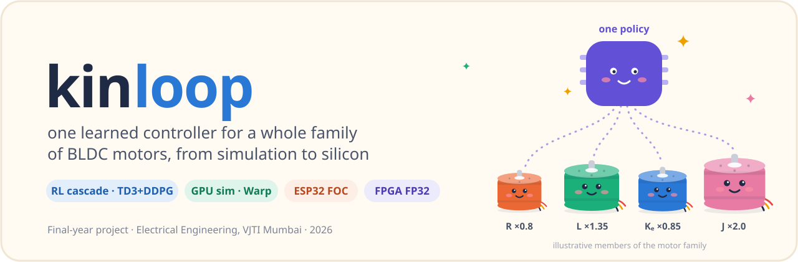
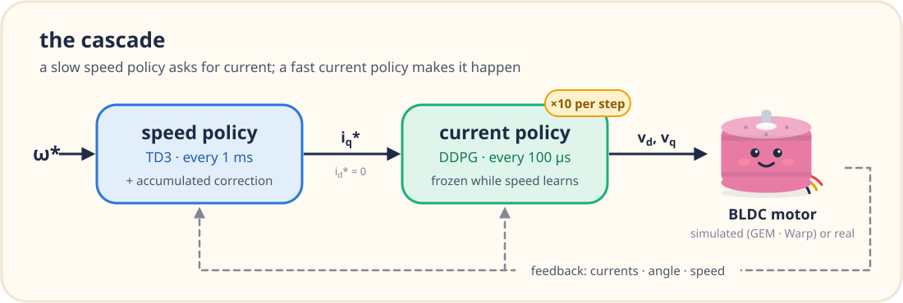
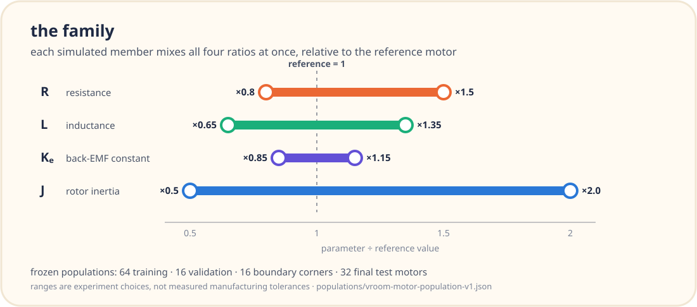
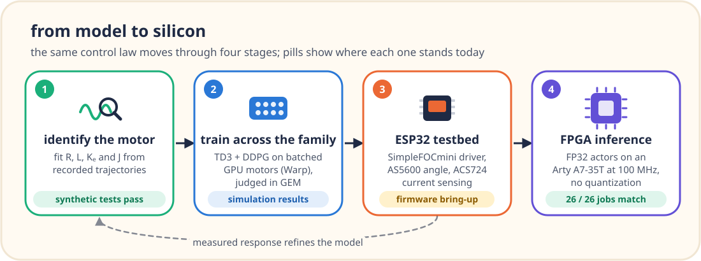
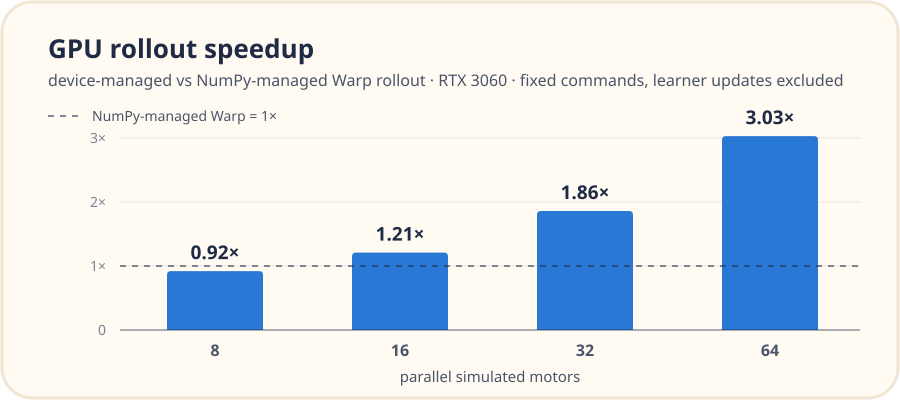
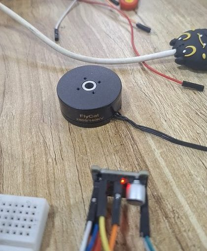

<p align="center">
  
</p>

<p align="center">
  <b>Can one learned controller drive a whole family of similar BLDC motors,<br>without retraining it for each motor?</b>
</p>

<p align="center">
  <a href="#how-it-works">How it works</a> ·
  <a href="#where-things-stand">Status</a> ·
  <a href="#results-so-far">Results</a> ·
  <a href="#hardware">Hardware</a> ·
  <a href="#quickstart">Quickstart</a> ·
  <a href="#repo-map">Repo map</a>
</p>

---

**kinloop** is our final-year project (code name in this repo: `vroom`). We keep
the classic speed → current cascade used in motor drives but replace both PI
controllers with neural networks trained by reinforcement learning, purely
from interaction with simulated motors. We then carry the same control law
from GPU simulation to an ESP32 testbed and onto an FPGA.

The claim we test is deliberately narrow: **reuse within a defined motor family**
(same structure and pole-pair count, bounded parameter ranges), not a
controller for arbitrary motors. PI stays in the project only as the baseline
to beat; it never provides demonstrations or warm starts.

## How it works

<p align="center"></p>

- **Current policy (inner).** DDPG actor, 25 inputs → 3×256 → 2 outputs
  (`v_d`, `v_q`), every 100 µs. Trained first, then frozen.
- **Speed policy (outer).** TD3 actor, every 1 ms, requests `i_q*` (with
  `i_d* = 0`), bounded to ±1.5 A. An explicit accumulated-correction state gives it
  the memory a PI integrator would normally provide (inspired by the IASA
  idea in [Weber et al. 2022](https://arxiv.org/abs/2201.13331); our bounds
  and projection are project choices).
- **Safety.** Phase-current trip at 4 A ends an episode as a failure; failures
  are reported, never silently reset.
- **Warp trains, GEM judges.** Training runs on batched GPU physics
  (`warp_backend/`, FP64, parity-tested); every selection and evaluation runs in
  [gym-electric-motor](https://github.com/upb-lea/gym-electric-motor) (submodule).

Exact network shapes and observation groups: [docs/policy-arch.md](docs/policy-arch.md).
Plain-language walkthrough: [docs/cascaded-loop-explained.md](docs/cascaded-loop-explained.md).

### The family

<p align="center"></p>

Populations are frozen and hashed in
[`populations/vroom-motor-population-v1.json`](populations/vroom-motor-population-v1.json);
details in [docs/motor-family.md](docs/motor-family.md).

### From model to silicon

<p align="center"></p>

## Where things stand

We separate *implemented*, *tested in simulation* and *measured on hardware*.
Nothing below is a claim about hardware unless it says "measured".

| Piece | State | Evidence |
|---|---|---|
| Inner current policy | ✅ qualified in nominal simulation | fresh current + hybrid speed cases passed at both seeds |
| Speed policy | 🟡 partial | 4 / 6 development cases per seed; reversal and negative speed still fail |
| GPU training backend | ✅ implemented, parity-tested vs GEM | [warp_backend/README.md](warp_backend/README.md), [docs/benchmark.md](docs/benchmark.md) |
| Motor family + PI baselines | ✅ implemented | [docs/motor-family.md](docs/motor-family.md), [docs/pi-baselines.md](docs/pi-baselines.md) |
| Motor identification | 🟡 method tested on synthetic data | physical fit pending; code not yet in this repo |
| ESP32 testbed | 🟡 FOC firmware bring-up | [hw/focmini/](hw/focmini/README.md); learned policy not yet deployed |
| FPGA actor inference | ✅ measured numerical agreement | [hw/arty/](hw/arty/README.md); weights streamed over UART, not yet a real-time loop |
| Family transfer on real motors | ⏳ planned | second physical motor after parameter check |

## Results so far

All numbers come from the thesis draft and the linked docs. Plant parameters
are assumed simulation values, not measured motor specifications.

**Speed control (simulation).** Across four seeds, the revised reward passes
4 of 6 development cases per seed, versus 0 of 6 for the comparison reward.
On startup, the learned speed loop tracks better than PI (speed RMSE
0.684 vs 0.917 rad/s) but draws more peak current (≈1.51 A vs 1.17 A), which is
exactly why reversal fails the current criterion. Both use the same frozen
learned current loop.

**Embedded actor pair (simulation).** The current controller used for the
hardware passes 18 of 24 current checks; the six failures are kept in the result.

**GPU rollouts.** Device-managed rollouts stay flat at ≈8.5 ms per vector step,
so the speedup grows with the number of motors simulated in parallel:

<p align="center"></p>

**FPGA.** Both trained actors run in binary32 on an Arty A7-35T at 100 MHz.
All 26 physical inference jobs (13 per actor) match software, with a maximum
absolute error of 7.60 × 10⁻⁷ against a 10⁻⁵ limit, plus 2,056 intermediate-value
checks and 16 fault/reset cases. This verifies the network arithmetic, not
closed-loop motor control.

## Hardware

<table>
<tr>
<td width="38%"></td>
<td>

| Part | Role |
|---|---|
| FlyCat 2805 / 140KV | reference BLDC motor |
| DFRobot SimpleFOCmini (DRI0058) | three-phase driver |
| ESP32-WROOM | FOC testbed controller |
| AS5600 | magnetic rotor angle |
| 2 × Pololu ACS724 ±5 A | phase current sensing |
| Digilent Arty A7-35T | FP32 actor inference |

Wiring, safety limits and bring-up steps:
[hw/focmini/README.md](hw/focmini/README.md).
FPGA architecture and verification:
[hw/arty/README.md](hw/arty/README.md).

</td>
</tr>
</table>

## Quickstart

**Simulation and tests**

```bash
git clone --recurse-submodules https://github.com/crisiumnih/vroom.git && cd vroom
python -m venv .venv && . .venv/bin/activate
pip install -r requirements.txt
pip install -e third_party/gym-electric-motor
python -m pytest -q warp_backend rl
python ui/render.py --run /path/to/results/bldc/<study> --out /tmp/kinloop-ui
```

GPU tests need CUDA and `warp-lang`; versions are pinned in `requirements.txt`
and the reference machine is recorded in [env/RECORD.md](env/RECORD.md).

**ESP32 testbed** (bench supply, read the wiring notes first)

```bash
./hw/focmini/run_motor.sh --port /dev/ttyUSB0              # AS5600 FOC program
./hw/focmini/run_motor.sh --program motor-test --port /dev/ttyUSB0
```

**FPGA inference check** (Vivado + Arty A7-35T): see the full sequence in
[hw/arty/board/README.md](hw/arty/board/README.md).

## Repo map

```text
warp_backend/        GPU motor physics, batched actors, sensing, waves, populations (+ tests)
rl/outer/            speed-loop controller contract, reward, controller
motors/, configs/    motor registry and nominal YAML configs (assumed parameters)
populations/         frozen, hashed motor-family populations
ui/                  static run viewer: status, key metrics, three graphs
docs/                design notes, benchmarks, results, figures
hw/focmini/          ESP32 + SimpleFOCmini firmware, serial tools, tests
hw/arty/             FP32 inference RTL, simulation, synthesis probes, board adapter
third_party/         gym-electric-motor (submodule), Berkeley HardFloat (vendored)
rl_legacy_cpu/       superseded CPU adapters, kept for reference only
```

## Ground rules

From-scratch RL only; frozen evaluation cases; identical plant, scenarios and
metrics for PI vs RL; failed runs kept and reported; simulation never described
as hardware. The full working conventions (for humans and coding agents) are in
[AGENTS.md](AGENTS.md).

## Team

Prajwal Avhad · Sanjyot Pawar · Suchit Garad · Shri Vishakh Devanand<br>
Guide: Dr. Pragati Gupta · Electrical Engineering, Veermata Jijabai Technological Institute (VJTI), Mumbai

Thesis: *A Learned Controller for a Family of Motors: Cascaded Reinforcement
Learning and Embedded Implementation* (2026, in preparation).
