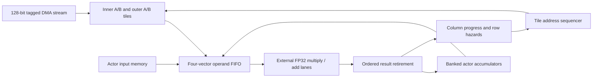

# Dense microtile executor

`rtl/vroom_dense_tile.v` is synthesizable Verilog-2005 control and storage for
FP32 dense-layer execution. `rtl/vroom_dense_tile_core.v` connects it to the four
existing weight tile buffers. Multiplication and addition are an **external
operator interface**, not an implemented FPGA floating-point datapath. The C/VPI
operator under `sim/` is simulation-only and is never passed to synthesis.



## Arithmetic and ordering

For each output neuron r, initialize its accumulator from the supplied bias and
process input columns in ascending order:

```
s[r,0]   = bias[r]
p[r,c]   = RN32(weight[r,c] * input[c])
s[r,c+1] = RN32(s[r,c] + p[r,c])
```

`RN32` means binary32 round-to-nearest, ties-to-even. Multiply and add round
separately; a fused multiply-add is not interchangeable with this contract.
The engine routes binary32 bit patterns without converting to integers or a
smaller precision. It does not implement ReLU, tanh, normalization, or controller
action transforms. Bias-first accumulation can differ numerically from a library
linear layer's reduction order. Checkpoint numerical/trajectory parity is still
required before treating this ordering as an accepted controller implementation.

One SIMD request handles up to `LANES` consecutive output neurons and broadcasts
one input value. Default lanes = 12; 16 is tested too. Output-row groups advance
first, then input columns. A row becomes busy when a weight read is accepted and
remains busy until the corresponding arithmetic result is stored. A later column
cannot read that row's old accumulator. Other independent row groups can proceed.

Sixteen vector reservations track work from memory request through retirement.
A four-vector FIFO holds weights, input, accumulators, mask, and ticket across
operator backpressure. Admission accounts for the next non-stallable weight
response, preventing FIFO overflow. The arithmetic port supports at most one
vector request and one vector result per cycle; actual rates depend on latency,
ready signals, row hazards, and tile boundaries. No initiation interval or
physical frequency is guaranteed by this interface.

## Context initialization

All interfaces use the same core clock with synchronous active-high reset.
There are two persistent contexts: actor 0 is inner; actor 1 is outer. Each stores
job ID, layer ID, dimensions, up to 256 input values, and up to 256 accumulators.
An unfinished context cannot be silently replaced.

1. Handshake `context_valid/context_accept` with actor, job, layer, and dimensions
   (each 1..256). This invalidates the selected context and enters initialization.
2. Feed exactly `context_inputs` words through `input_valid/input_ready`, in
   ascending input index, and exactly `context_outputs` biases through
   `bias_valid/bias_ready`, in ascending output index. The two streams can overlap
   or stall independently. Indices are generated inside the engine.
3. `context_ready[actor]` becomes true after both streams finish. Each output's
   next column is now zero. The other actor's memory remains intact.

Initialization occupies the engine, so it does not overlap execution. Reset
invalidates both contexts without clearing payload RAM. A completed context can
be replaced by a new explicit header; the caller must consume its outputs first
if needed. Job/layer sequencing across an entire policy is still the caller's
responsibility. Dimensions are generic microkernel parameters, not a change to
the checkpoint's observation or action contract.

## Tile commands and safe switching

Handshake `command_valid/command_ready` with actor/job/layer, buffer ID, transfer
tag, first row, row count (1..128), first column, and column count (1..4).
All row/column ranges must fit the context. The weight count must be a multiple
of four, matching the 128-bit tile DMA interface. Buffers 0/1 belong to inner;
2/3 belong to outer.

The loader must associate a unique transfer tag with the exact command geometry
and weight payload. The executor checks buffer ownership and acquisition tag;
it cannot identify which checkpoint matrix the bytes came from. It also checks
the job/layer identity and every target row's stored next-column index. Skipping
or replaying columns faults instead of silently changing a dot product.

```
IDLE -> CHECK -> ACQUIRE -> ISSUE -> DRAIN -> RELEASE -> DONE -> IDLE
```

CHECK scans groups of rows before acquiring the buffer. ISSUE requests column-major
tile words at `local_column * row_count + local_row`. DRAIN waits for every
reserved operation to retire, including operands stalled before the FP32 port.
Only then does RELEASE return the buffer to EMPTY. DONE holds completion and
actor/job/layer identity until `done_ready`.

The next command may select either actor after this boundary. Partial accumulators
and column progress are retained separately for both. This implements safe
switching **between completed microtiles**, not interruption halfway through a
tile and not a two-rate dispatcher. A preemptive scheduler must wait for the drain
boundary. This module introduces no one-millisecond outer command delay.

`context_complete[actor]` becomes true after all its output rows retire their last
input column. The result-read interface returns up to `LANES` consecutive output
words with a mask, job ID, and layer ID. Requests are accepted only when the
engine is idle and the requested context is complete. Responses are registered
and have no backpressure; the receiver must accept every valid response.

## Operator and memory timing contracts

- Every accepted tile read returns exactly one cycle later, with the same mask.
  This matches `vroom_weight_tiles`; a future cache router must preserve it or add
  an explicit response handshake before changing this assumption.
- `mac_valid/mac_ready` transfers a complete vector. All payload fields stay
  stable until accepted. The FP32 adapter must keep lanes synchronized and respect
  the mask.
- Results must arrive **in order**, with the unchanged 32-bit ticket, at least one
  cycle after request acceptance. Variable latency and input backpressure are
  supported. Responses with unknown, duplicate, early, or reordered tickets fault.
- The engine accepts one valid result per cycle while healthy. Shared reset must
  flush the arithmetic pipeline and DMA/CDC bridge as well as the core. Its ticket
  counter alone is not a reset epoch: an old response must never be permitted to
  alias a newly allocated ticket after reset.
- The pinned W1 cache is not routed into this executor yet. All integrated tests
  currently use the tile-buffer source. The top level has no MIG, DDR pins, vendor
  floating-point IP, clock-domain crossing, constraints, or actuator I/O.

The input store contains 2 KiB of logical payload. Accumulators use sixteen
single-read/single-write banks of 32 words (2 KiB total); column-progress banks
add 576 bytes. Queue/control storage is additional. These choices extend the
earlier resource sketch; complete LUT/BRAM/DSP use and physical timing must be
re-budgeted after operator and DDR IP generation. Generic Yosys memory inference
is not evidence of fit on an Arty A7-35T.

The bank selectors use bounded unsigned addresses. For starting row `r` and
physical bank `b`, the per-actor row group is
`((r >> 4) + (b < (r & 15))) mod 16`; the actor bit selects the upper/lower
half of the 32-word bank. At most sixteen consecutive rows touch each bank once.
`vroom_bank_rotate.v` uses four shared mux stages to route bank `(r + lane) mod 16`
to that lane. Reverse rotation routes a retiring vector and its mask back to
physical banks. Data and column-progress payloads rotate together. There is no
added register stage, change to arithmetic ordering, or change to valid/ready
timing. Row bounds use full-width sums before addresses are narrowed; validated
commands limit the busy-row scoreboard to 128 rows.

## Faults

Faults latch until joint reset and stop command, DMA, arithmetic-request, and
result handshakes. Valid work already accepted on the failing edge can have
modified memory; the episode is invalid and cannot be resumed as successful.

| Engine code | Meaning |
| --- | --- |
| 1 | Invalid context dimensions, tile range/count, or actor-buffer ownership |
| 2 | Context not ready/unfinished job already complete, or job/layer mismatch |
| 3 | Skipped or repeated input columns |
| 4 | Weight-response latency/mask or operand queue protocol failure |
| 5 | Unexpected or wrong-ticket arithmetic response |
| 6 | Fault reported by the weight buffers |
| 7 | Result read outside the completed output range |

The separate buffer fault mask/codes remain visible on the core. A permanently
stalled operator does not fabricate a completion: the external deadline monitor
must terminate that episode. This executor has no independent timeout policy.

## Verification and current performance limit

Run:

```sh
python3 hw/arty/sim/run.py --suite dense --seed 2805 --lint --synth-check
```

This requires Icarus Verilog plus its `iverilog-vpi` helper, a C11 compiler, and
Verilator/Yosys for the optional checks. The runner builds the test-only C operator
with contraction and fast math disabled. A rounding canary distinguishes it from
FMA; another checks gradual underflow. This does not exhaustively qualify a future
FPGA floating-point implementation or specify NaN payload propagation.

Synthetic fixtures exercise 25->256, 19->256, 256->256, and 256->2 dense layers.
They are not checkpoint exports, and they are initialized independently rather
than connected into an end-to-end network. A Python reference rounds each multiply
and add separately. Tests cover both lane counts, 3- and 19-cycle operator models,
full column ranges, unaligned output groups, masks, independent actor contexts,
DMA/compute overlap, operand queue saturation, stalls, context replacement,
drained switching, malformed descriptors/results, and reset in flight.

Each configuration checks 77,312 main-case scalar MACs and 770 output words
bit-for-bit, plus recovery after reset. All intentional fault tests are named in
the raw logs; failure runs are retained. VCD, generated fixtures, output CSVs,
command events/timings, metrics, source/tool identities, hashes, and readable
summaries are saved in unique ignored result directories.

The bank-logic regression appends a 4->256 case: row-group lengths 1 through 16
visit every starting bank, followed by a 120-row group. This checks another
1,024 scalar MACs and 256 distinct outputs per configuration. Completed result
reads cover all 256 starting rows with dense and sparse masks (512 windows),
including the final masked tail and an explicit out-of-range read. The original
numerical workload and command-cycle trace precede these added cases, so their
timing remains directly comparable. `sim/compare.py BASELINE CURRENT` compares
all saved original outputs and command timings in a new evidence directory.

The first measured cycle sums at seed 2805 are:

| Lanes | Simulated operator latency | Inner-shaped dense command cycles | At a nominal 100 MHz |
| --- | --- | --- | --- |
| 12 | 3 | 13,131 | 131.31 us |
| 16 | 3 | 10,452 | 104.52 us |
| 12 | 19 | 23,794 | 237.94 us |
| 16 | 19 | 22,606 | 226.06 us |

These sum command acceptance through drained completion for the inner-shaped
layer tests, including simulated operator stalls. They **exclude** initialization,
DMA between commands, activation functions, controller arithmetic, and dispatch
between commands. They are neither end-to-end timings nor hardware measurements.
This functional implementation does not yet meet the 100 us inner budget.
Feedback dependencies (especially the two-output layer), per-tile checking/draining,
and operator stalls are visible costs. Next throughput work must address those
measured costs while preserving or separately validating FP32 reduction semantics.
