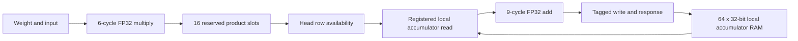

# Measured FP32 multiply-ahead lane

Implemented and numerically tested on `codex/fp32-arty-cache`. This is one
synthesizable lane for the proposed streaming engine; it is not connected to the
baseline dense core, weight cache, DDR, controller adapter or physical hardware.
No quantization, checkpoint export, or board programming was performed.

The retained initial single-lane open-flow probe meets its 100 MHz internal-clock constraint.
It uses the existing larger-fabric chip database, so it is **not Arty-35T timing
sign-off**. The full controller's 100 us deadline and resource fit remain unproven.

## Arithmetic and pipeline

For each local row, in submitted column order:

```
p = RN32(weight * input)
accumulator = RN32(accumulator + p)
```

Bias is loaded before the first update. Every product and sum is rounded to
binary32, nearest/even; no FMA, partial-sum tree, extended accumulator or flushed
subnormal is substituted. All NaN results are canonical positive `0x7fc00000`.
Five exception bits are invalid/divide-by-zero/overflow/underflow/inexact;
divide-by-zero is always zero for these operations. Lane flags OR the product
and sum flags for that update; they are not sticky across a whole inference.

Unmodified [Berkeley HardFloat Release 1](../../../third_party/hardfloat/README.vroom.md)
provides binary32 recoding/decoding and primitive functions. The repository-owned
`*_raw_pipe.v` and `*_round_pipe.v` retain the upstream BSD headers and derive
from `mulRecFNToRaw`, `addRecFNToRaw`, and `roundAnyRawFNToRecFN` respectively.
The latter is specialized to binary32/RNE/tininess-after/canonical NaN. Upstream
files are unchanged. Recoded values have 33 representation bits but retain
exactly the same binary32 numerical values.

The integrated timing follow-up now uses `vroom_fp32_recode.v` for input recoding.
Its six parallel nibble encoders replace the original carry-based leading-zero
calculation. `sim/prove_recode.py` proves bit-for-bit equivalence to pinned
`fNToRecFN(8,24)` for every 32-bit input, including subnormals, both zeros,
infinities and NaN payloads. The proof is combinational SAT with no input
constraints; it does not claim formal proof of the full arithmetic pipeline.
The 6/9-clock operator latencies and IEEE rounding/subnormal behavior are unchanged.

Proof: `results/arty_fp32/recode-proof-20261010T020200-o7q6tgyo`.
Full numerical/lane regression after the change:
`results/arty_fp32/lane-20261010T020055-s80ab7tw`. Both pass. Reproduce with:

```sh
python3 hw/arty/fp32/sim/prove_recode.py
python3 hw/arty/fp32/sim/run.py
```

`vroom_fp32_round_mask.v` similarly specializes the gradual-underflow mask:
bit `i` is `exponent < 130-i`. The parallel constant comparisons replace the
generic signed-shift/reverse construction without changing the mask or adding
pipeline stages. SAT equivalence to `lowMaskLoHi(9,105,130)` passes for all 512
exponent bit patterns in `results/arty_fp32/round-mask-proof-20261010T024047-h0fz5qau`.
Run `python3 hw/arty/fp32/sim/prove_recode.py --unit round-mask` to reproduce.
The complete 131,272-operation and 21,760-MAC regression passes again in
`results/arty_fp32/lane-20261010T024047-zg0otsrh`.

The isolated area/timing table below records the earlier implementation; current
multi-lane timing is measured separately in the [stream report](../stream/README.md).

| Unit | Registered stages | Transfer latency | Independent-operation II |
| --- | --- | ---: | ---: |
| Multiply | recode; two exact partial products; combine/sticky; significand rounding; exponent/flags; IEEE decode | 6 clocks | 1 clock |
| Add | recode; exponent compare; align/subtract; magnitude/add; leading zeros; normalize; significand rounding; exponent/flags; IEEE decode | 9 clocks | 1 clock |

The multiplier splits its 24x24 significand product into registered 24x17 and
24x7 products. All 48 product bits participate before sticky reduction. This
avoids the initial long combinational DSP cascade without truncation.

Operator requests transfer when `enable && valid` at a rising edge. Responses
transfer when `enable && response_valid`; deasserting enable holds all data,
flags, tags and validity together. A request accepted at edge n transfers its
response at n+6 or n+9. Synchronous active-high reset cancels all pending work.
Consumers must apply this transfer convention, not count post-edge visibility
as another accepted response while the pipeline is frozen.



The lane always enables its operators; input `ready` handles backpressure. The
16 credits include products still in the multiplier. A product written to the
FIFO is readable the following edge. Dequeuing a product reserves its row and
registers both adder operands; that row remains busy until retirement. A later
update cannot read it until the edge following the write: measured repeated-row
feedback is **11 clocks** (read register + 9-cycle add + write visibility).
No same-edge RAM forwarding is assumed. Independent rows sustain one result
per clock. Responses have no backpressure and must always be consumed.

`tag[5:0]` selects one of 64 accumulators; the upper ten bits return as opaque
metadata. Initialization is accepted only when drained and blocks new requests.
Reset invalidates initialization/busy state and flushes requests without clearing
RAM payloads; rows must be reinitialized. Explicitly multiplexing initialization
and retirement produces one physical accumulator write port. The local RAMs are
LUTRAM, not BRAM. This prototype has one queue, no actor priority, and no validation
of expected column numbers; its upstream layer scheduler must enforce order.

## Numerical and protocol evidence

Final run: `results/arty_fp32/lane-20261009T235616-exrpbivj` (seed 2805).

- 65,636 operand pairs: 3,136 directed cross-products, 50,000 random bit-pattern
  pairs, and 12,500 near-cancellation pairs; 131,272 add/multiply results and
  exception flags matched an exact Python-integer reference.
- The reference was cross-checked against native C binary32 with contraction
  disabled. Sixteen cases differ only in the host's before-rounding tininess
  policy; acceptance is restricted to exact tiny products rounding to minimum
  normal with the sole extra underflow bit. All other values/flags are strict.
- 21,760 sequential MACs across 1/2/16/22/44 local rows matched exact unfused
  results, flags and tags. Tests include subnormal/overflow/NaN propagation,
  full-queue backpressure, a canary that distinguishes FMA, initialization, and
  reset while an accumulator update is in flight.
- Operator tests verified exact enabled-edge latency, II=1, 16,070 frozen-clock
  cycles, and cancellation on reset. Lane cases with 16/22/44 rows returned
  every clock for 4,096/5,632/11,264 consecutive operations respectively.
- Strict Verilator lint passed for all three public tops. Waivers are scoped
  only to unmodified upstream source; repository-owned RTL has no waivers.

Tininess-after requires rounding to 24-bit precision with an **unbounded**
exponent before checking tininess. Looking only at the final encoded subnormal
bit pattern is incorrect. The initial reference made that mistake; its failed
run is retained. The corrected oracle has separate canaries for both sides of
this boundary. See the [SoftFloat FAQ](https://www.jhauser.us/arithmetic/SoftFloat-3/doc/SoftFloat-FAQ.html).
These synthetic tests are substantial development coverage, not exhaustive
formal proof or checkpoint/trajectory parity.

## Synthesis and routed diagnostic

Final run: `results/arty_openflow/probe-20261009T235434-ik18afa8`, seed 2805.
System Yosys 0.63 and Apio 1.6.0-provisioned openxc7 nextpnr were used in native
mode. Exact versions, source/tool/chipdb hashes, generated fixtures, mapped
netlists, raw logs and all commands are retained in that directory.

| Unit | Diagnostic Fmax | Logic LUT1–6 cells | FF cells | DSP48E1 |
| --- | ---: | ---: | ---: | ---: |
| Multiply | 116.14 MHz | 684 | 232 | 2 |
| Add | 108.46 MHz | 915 | 477 | 0 |
| Whole lane | **103.62 MHz** | **1,952** | **924** | **2** |

Area is measured by a separate DUT-only synthesis, without scan registers.
The lane additionally uses 10 RAM32M, 11 RAM64M and 62 SRL16E primitives, and no
BRAM. LUT1–6 counts do not include those memories/shifters, INV cells or packing
constraints. Logical LUT counts are **not physical packed LUT site counts**.
Yosys' rough LC estimate is 1,510 for this lane; it also is not device-fit proof.
Timing includes the four-pin registered scan fixture and its routing.

At fixed 100 MHz, the lane has only about 0.35 ns of modeled clock margin.
The nominal 35T database reports 75 BRAM36 and 120 DSP sites, revealing its 50T
fabric mapping; an actual 35T has 50 and 90. A successful probe cannot establish
35T routing, speed-grade accuracy, board timing, or multi-lane timing closure.
Constant-connectivity checks were not bypassed. No clocks were raised to hide a
100 us schedule failure.

The retained development probes explain the pipeline cuts:

| Probe suffix (all in `results/arty_openflow/`) | Outcome |
| --- | --- |
| `probe-20261009T233245-gemugpz7` | External-stage registers only: multiply 62.98 MHz, add 45.24 MHz; lane RAM mapping failed on two write ports |
| `probe-20261009T234931-4nhou78c` | Internal raw arithmetic pipelined: multiply 80.37, add 99.79, lane 71.66 MHz |
| `probe-20261009T235201-2jv7xfdm` | Rounding cut; contains a subsequently detected special-value encoding bug, so its arithmetic is invalid evidence despite operator timing passes; lane 87.21 MHz |
| `probe-20261009T235434-ik18afa8` | Corrected rounding and registered accumulator read; all numerical tests and three clock probes pass |

Failed simulation directories are retained too: `233819-rfc8lrz1` (native
reference tininess), `234853-pzdij4y9` (oracle boundary), `234930-oks37mhm`
(Icarus parameter argument ordering), and `235153-7i2x8xf7` (special-value
encoding). Full prefixes are `results/arty_fp32/lane-20261009T...`.

## Consequence for the 100 us schedule

The conditional model uses M=7: six multiplier clocks plus one FIFO visibility
clock. F=11 is measured. It counts final row availability, one clock after the
last RTL write. All five 256-column lane traces match this model with that
explicit endpoint difference. At 100 MHz, assuming continuously ready weights
and inputs, initialized biases, II=1 and enough product credits:

```
G = ceil(outputs / lanes)
layer cycles = (inputs-1)*max(G,F) + (G-1) + M + F
```

| Lanes | Inner compute | Outer compute | Ten inner + one outer / 1 ms |
| --- | ---: | ---: | ---: |
| 8 | 118.49 us | 116.57 us | 130.15% |
| 10 | 101.63 us | 100.07 us | 111.64% |
| 12 | 90.39 us | 89.07 us | **99.297%** |
| 16 | 73.53 us | 72.57 us | **80.787%** |

Twelve lanes leave only **703 clocks = 7.03 us per millisecond** for all excluded
work and unhidden stalls. This is not enough evidence to accept that architecture.
Sixteen improve compute margin, but replicating this lane without sharing gives
31,232 logic LUT cells plus memories/shifters; twelve give 23,424, versus 20,800
physical LUT sites on the 35T. These are warnings about area pressure, not a
packed multi-lane measurement: synthesis can share control and LUT packing changes
the mapping. DSP use alone (24 or 32) is not the limiting estimate.

No 12/16-lane choice is accepted yet. Sharing SIMD control/tag queues, avoiding
unnecessary format conversions in the feedback path, and reducing rounding/control
logic are the next full-FP32 options to measure. The existing weight-residency,
DDR service, nonlinear activation and complete scheduling questions remain.

## Reproduce

```sh
python3 hw/arty/fp32/sim/run.py --seed 2805 --random-pairs 50000
python3 hw/arty/synth/run.py --native-tools --cases fpmul fpadd fplane
uv run --no-project --with matplotlib==3.10.8 python hw/arty/sim/stream_budget.py \
  --lanes 8 10 12 16 --mul-latency 7 --feedback 11
uv run --no-project --with matplotlib==3.10.8 python hw/arty/fp32/summarize.py \
  --simulation results/arty_fp32/lane-20261009T235616-exrpbivj \
  --probe results/arty_openflow/probe-20261009T235434-ik18afa8 \
  --budget results/arty_architecture/stream-20261009T235443-zydjp8rv
```

Each run creates a unique directory, retaining failures. Verification requires
Python 3.9+, Icarus, Verilator and a C11 compiler. Routing requires system Yosys
and the already installed Apio openxc7 package/chipdb; it downloads nothing.
Full CSV transfer traces and vectors are retained. VCDs cover the initial 1,024
requests (entire short cases); later numerical transfers remain in CSVs.

Joined report and figures: `results/arty_fp32/report-20261009T235755-jh413ort`.
Its report verifies byte-identical numerical-test and routed RTL snapshots.
Raw numerical evidence records source/submodule hashes, seeds, versions,
configuration and completion status. No failed case is silently retried into
its original directory or omitted from this history.
