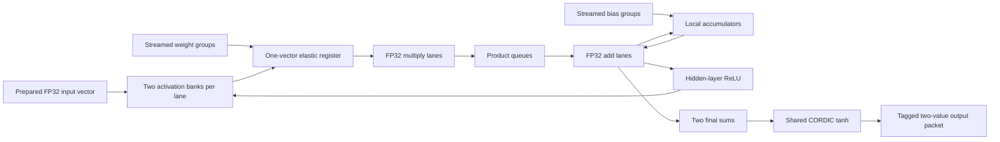

# Complete FP32 actor stream

`rtl/vroom_actor_stream.v` implements one complete inference job using real
synthesizable FP32 multiply/add lanes and the shared CORDIC tanh unit. It accepts
prepared observations and streamed biases/weights, runs all three dense layers,
and returns one tagged packet containing both actor outputs. No model payload is
quantized. The regression uses synthetic weights, not an exported checkpoint.

Status: implemented and functionally tested at 12 and 16 lanes. The current
12-lane implementation passes the 100 MHz open-flow diagnostic at **100.65 MHz**
with seed 2805. This is a serial job engine. Cache/DDR routing, concurrent actor
scheduling, actual checkpoint parity, and physical 35T fit/sign-off remain unproven. Motor observations,
action transforms, sensors, and actuator interfaces are outside this delivery.



## Numerical contract

Actor 0 is inner `25 -> 256 -> 256 -> 2`; actor 1 is outer
`19 -> 256 -> 256 -> 2`. Weights, biases, stored activations and outputs are
IEEE binary32 bit patterns. Prepared input ordering/scaling belongs to the caller.
For each dense row, in ascending input-column order:

```
s[r,0]   = bias[r]
p[r,c]   = RN32(weight[r,c] * input[c])
s[r,c+1] = RN32(s[r,c] + p[r,c])
```

RN32 means round to nearest, ties to even, with gradual underflow. Multiply and
add round separately; there is no fused MAC or reduction-tree reassociation.
Hidden-layer ReLU returns +0 for negative nonzero values and retains signed zero.
Only the two final outputs use tanh. See the [FP32 lane](../fp32/README.md) and
[CORDIC implementation](../tanh/README.md) for arithmetic details and numerical
limits. CORDIC's wider internal fixed working format is not weight quantization;
it has binary32 input/output and does not claim an all-input correct-rounding proof.

All active inputs, biases and weights must be finite. A nonfinite intermediate
arithmetic result faults the job; underflow and inexact finite results are allowed.
`arithmetic_flags[4:0]` ORs the dense operations' invalid, divide-by-zero, overflow,
underflow and inexact flags, in that order. It does not report tanh inexactness.

## Stream protocol

All transfers occur on a rising `clk` edge with `valid && ready`. A source must
hold its payload and metadata stable until accepted. All interfaces use one core
clock and synchronous active-high reset. There is no CDC or memory controller.

1. Submit `job_valid`, `job_actor` and 32-bit `job_id` when `job_ready` is high.
2. Supply exactly 25 inner or 19 outer scalar `input_data` words. Assert
   `input_last` on exactly the final word.
3. For each layer 0, 1, 2, supply every bias group before its weight stream.
   Group `g` contains rows `g*LANES + lane`, with lane 0 in bits `[31:0]`.
   Layers 0/1 have `ceil(256/LANES)` groups; layer 2 has one group.
4. Supply weights in ascending column order, then ascending group order within
   that column. `weight_data[lane*32 +: 32] = W[g*LANES+lane, column]`.
   The source is backpressured while a pending vector or lane credit is blocked.
5. Consume one `output_valid` packet with `output_ready`. `output_data[31:0]`
   is output 0, `[63:32]` output 1, with the original `output_actor/output_job`.
   Data, identity and flags remain stable while stalled. A new job is admitted
   only after the packet has been consumed.

Each bias vector carries `bias_job`, `bias_layer`, `bias_group`, and `bias_last`.
Each weight vector additionally carries `weight_column`. All must equal the
next expected job/layer/column/group. `bias_last` marks the last group of its
layer; `weight_last` marks the last group of the last column of its layer.
Metadata is checked on acceptance; there is no reordering or retransmission.
Layers advance automatically after every active lane's final result has retired.
The frontend must know the fixed model dimensions; this interface does not issue
DDR addresses or load requests. `layer/debug_state` are diagnostic outputs.

Inactive tail slots are ignored, including their numerical payload. At 12 lanes,
the last hidden group contains four active rows; at 16 lanes all hidden groups
are full. The final layer always uses only lanes 0 and 1. Poisoned inactive slots
are explicitly covered by simulation.

## Storage and flow control

Row `r` always belongs to lane `r % LANES`, local group `floor(r/LANES)`.
`vroom_fp32_simd.v` shares credits, tags, masks and row-hazard tracking across the
lanes. Each lane has `2**ceil(log2(ceil(256/LANES)))` local accumulator slots:
32 at 12 lanes or 16 at 16 lanes. The fixed layer protocol initializes every
used group before issuing weights; there is no replicated initialization bitmap.
The FP32 operators and the 11-clock repeated-row feedback interval are unchanged.

Each lane has a 16-entry product shift queue, with the 16 credits including
multiplies still in flight. Tags/masks use a shared shift queue. Two registered
head slots sit between these queues and accumulator arbitration. Pop control is
registered using the next queue/head occupancies, reserving both data and a free
head slot. Refilling a head slot overlaps issuing the preceding one, retaining
one vector per clock without a combinational hazard-to-payload-enable path.
One-hot head rows serve the local hazard check; binary tags serve data addressing.
`vroom_stream_shift.v` makes the per-bit shift/tap structure explicit
for SRL inference. A separate tap counter maintains `(queued-1) mod 16` to avoid
a carry chain before the distributed read. Occupancy and credit invariants are
checked during the full inference regression.

All physical lanes advance in lockstep, including inactive tail slots; the
aligned mask suppresses those slots' architectural results and exception flags.
Internal payload writes may occur on a reset edge, but synchronous reset clears
all ownership/validity. This keeps reset out of long combinational payload-enable
paths. No payload memory needs clearing before reinitializing a layer. Single-clock
reset recovery is covered by the protocol regression.

The top has one elastic weight-vector register. It captures the broadcast
activation, lane mask and `{column, group}` tag alongside the payload. All active
lanes issue together only when ready. The register can accept the next vector on
the same edge as the old one issues; arithmetic continues during source gaps.
An empty or consumed slot samples payload even without a valid transfer;
`pending` alone owns validity. A blocked live slot holds its payload. This keeps
stream-state/valid decoding out of the wide payload clock enable. MAC readiness
depends only on product credits. Initialization waits for drained arithmetic and
no MAC request, so simultaneous request types cannot both transfer. Drain status
is registered conservatively: new arithmetic clears it on acceptance; becoming
idle may take one extra clock. Layer reset sets it immediately for the next bias
stream. The regression asserts initialization readiness never overlaps live work.
No whole-layer weight storage is required by this module.

Each lane has two distributed-RAM activation banks with one shared write port.
Input loading writes bank 0; hidden-layer final sums write the opposite source
bank after ReLU. Bank roles swap only after the layer drains. Logical activation
storage is `2 * 2**ceil(log2(ceil(256/LANES))) * LANES * 4` bytes: 3,072 bytes at
12 lanes or 2,048 at 16. The power-of-two stride makes bank selection a single
address bit, removing an adder before the RAM read. Synthesis primitive allocation
may be larger. A scalar lane/group
read counter advances at the last weight group of each input column, avoiding
dynamic division/modulo and an extra fetch bubble on every column.
Read addresses are registered using the next group value when the last lane of
a group is consumed. The bank's one-clock delay is hidden by bias loading. This
look-ahead preserves the one-group output layer's consecutive-column behavior.
In the retained mapped netlist, Yosys merges the equivalent lane-address registers
into one six-bit register; the passing result does not claim physical replication.

The final two sums enter a shared serial tanh unit. The next job waits for tanh
and output consumption; this version does not overlap another actor's dense
work with activation. A 10:1 release scheduler is not implemented here.

## Fault and reset behavior

| Code | Sticky job failure |
| --- | --- |
| 1 | Wrong input `last` or nonfinite active input |
| 2 | Wrong bias identity/order/`last` or nonfinite active bias |
| 3 | Wrong weight identity/order/`last` or nonfinite active weight |
| 4 | Wrong/duplicate lane return metadata or nonfinite arithmetic result |
| 5 | Wrong tanh response tag or tanh invalid flag |

A fault invalidates the whole job, suppresses handshakes/output, and flushes
arithmetic validity. A separate sticky failure latch handles this independently
of the normal sequencing FSM; `debug_state` still reports FAILED (10). Internal
payload/state after failure is invalid until reset and cannot publish output.
A beat on the fault-detection edge may already have updated
internal payload storage. Reset is the only recovery; no partial result is
published. RAM contents are not reset. Subsequent jobs initialize every location
they will read before using it. There is no missing-transfer timeout inside this
module; the external scheduler will need one for a bounded deadline.

Input/bias/weight validation and per-lane return validation are registered before
the controller observes them. Failure becomes sticky on the following edge.
Finite checks are registered beside each lane; metadata checks are registered
centrally. Each lane also registers completion on its final-row retirement, so
the layer transition reduces done bits rather than long live row comparisons.
An additional beat may be accepted in that interval, but belongs to the failed
job and is flushed with it. Layer drain prevents a bad final sum from reaching
output publication. This pipeline cuts long validation/state feedback paths;
the regression checks error codes, absence of partial output and reset recovery.

Reset cancels accepted work and any held output. The source must jointly reset
or flush outstanding streams: job IDs do not create an epoch barrier, and the
untagged input stream cannot distinguish pre-reset data. Neither DMA cancellation
nor asynchronous reset isolation is implemented.

## Verification and observed cycle counts

Run from the repository root:

```sh
uv run --no-project --with matplotlib==3.10.8 python hw/arty/stream/sim/run.py
python3 hw/arty/synth/run.py --synth-only --cases stream12 stream16
python3 hw/arty/synth/run.py --native-tools --timeout 300 --cases stream12
```

The retained regression is
`results/arty_stream/inference-20261010T025551-iykx9adm` (seed 2805).
Four independent synthetic jobs per width cover both actors, continuous source
availability and injected source gaps. Every dense output and hidden ReLU is
compared with an independent integer FP32 reference; final CORDIC results also
receive a high-precision Decimal tanh cross-check. A cancellation canary detects
accidental FMA use. Both widths produce identical final bits.

Coverage: 4,112 checked dense outputs across eight ordinary inferences, 32
protocol/fault/reset cases across both widths, output backpressure with a queued
job attempt, poisoned inactive lanes, nonfinite inputs, malformed metadata,
finite arithmetic overflow, live-accumulator reset and held-output reset. Each
width additionally executes a zero network for the held-output cancellation test.
Known synthetic jobs run successfully after the reset/fault probes. Strict
Verilator lint and Icarus Verilog simulation pass for both widths.

| Lanes | Inner, ready source | Outer, ready source | Inner, source gaps | Outer, source gaps |
| --- | ---: | ---: | ---: | ---: |
| 12 | 9,478 clocks / 94.78 us | 9,337 / 93.37 us | 11,819 / 118.19 us | 11,505 / 115.05 us |
| 16 | 7,780 clocks / 77.80 us | 7,675 / 76.75 us | 9,395 / 93.95 us | 9,387 / 93.87 us |

Times assume 100 MHz; these are RTL simulation cycle counts, not physical clock
measurements. They include job admission, prepared input loading, all bias loads,
all three dense layers, hidden storage/ReLU and tanh through first complete
output-valid. Consumer output stalls occur afterward. The ready-source fixture
supplies a full LANES-wide vector whenever permitted. Injected gaps use a seeded
one-in-eight opportunity for a three-clock source pause; they do not bound DDR
service. All weights stream from the testbench; the existing cache is not attached.

Even with ready data, extrapolating ten inner jobs plus one outer job takes
104,117 clocks at 12 lanes and 85,475 at 16, before job handover/output waits.
Thus this serial 12-lane version exceeds the 100,000-clock aggregate millisecond
budget despite its isolated inner latency being below 100 us. The 16-lane
aggregate has cycle margin, but this arithmetic alone is not a release/deadline
schedule proof. The output layer's two active rows still pay the repeated-row
FP32 feedback cost.

## Current 100 MHz diagnostic

Retained route: `results/arty_openflow/probe-20261010T025550-cvakmxa4`.
Matched verification/physical report with figures:
`results/arty_stream/report-20261010T030128-rst0pv65`.

| Quantity, 12 lanes | Current result |
| --- | ---: |
| Requested clock | 100 MHz / 10 ns |
| Fully routed diagnostic Fmax | **100.65 MHz** |
| Diagnostic timing margin | Approximately **0.065 ns** |
| DUT logic LUT1–6 cells | 19,456 |
| DUT estimated LCs / FF cells | 15,653 / 10,554 |
| DSP48E1 / BRAM36 | 24 / 0 |
| Distributed RAM / shift primitives | 167 RAM32M, 132 RAM64M, 863 SRL16E |

This run uses the standard Yosys mapper, **without `--abc9`**, and nextpnr seed
2805. Placement and routing complete, all required constant connections route,
and the reported clock exceeds the unchanged 100 MHz constraint. The critical
path is now inside FP32 add alignment. The area numbers exclude the registered
scan fixture; timing includes it. Logical LUT counts/LC estimates are not packed
physical site counts. The installed nominal 35T database still exposes larger
50T fabric, so this is not actual Arty-35T sign-off. The small margin must not be
carried into an integrated DDR/cache design without a new implementation run.

Changes include shared SIMD credit/tag/hazard control, explicit SRL queues with
two head slots, registered queue and initialization control, power-of-two
activation banks with look-ahead addresses, registered validation/completion,
and a separate sticky failure latch. Balanced FP32 recoding and the parallel
underflow mask have all-input SAT equivalence proofs. Tanh admission computes
its shift amount early, and separate ROUND/PACK states add one clock per regular
output. FP32 weights, stored activations, separate multiply/add rounding and
gradual underflow are retained. No quantization or checkpoint export is used.

All earlier physical failures and intermediate probes remain in their own result
directories. The last tested 16-lane physical attempt before the final controller
cuts, `probe-20261010T024047-yj76is6n`, fails constant routing; the final 16-lane RTL
is functionally tested but has no accepted physical probe. The serial 12-lane
aggregate still takes 104.117% of a millisecond for ten inner jobs plus one outer
job: passing this clock does not prove both requested rates or bounded DDR service.

```sh
uv run --no-project --with matplotlib==3.10.8 python hw/arty/stream/summarize.py \
  --verification results/arty_stream/inference-20261010T025551-iykx9adm \
  --probe results/arty_openflow/probe-20261010T025550-cvakmxa4 --figures
```

## Retained initial baseline

The initial DUT-only Yosys mapping, before the shared SIMD/timing work, in the physical probe at
`results/arty_openflow/probe-20261010T012216-m91bv1h9` reports:

| Lanes | Logic LUT1–6 cells | Estimated LCs | FF cells | DSP48E1 | BRAM36 |
| --- | ---: | ---: | ---: | ---: | ---: |
| 12 | 24,242 | 17,452 | 12,386 | 24 | 0 |
| 16 | 31,564 | 23,639 | 16,156 | 32 | 0 |

Additionally, 12 lanes use 120 RAM32M, 264 RAM64M and 566 SRL16E primitives;
16 use 256 RAM32M, 176 RAM64M and 750 SRL16E. Logic LUT-cell counts and the
Yosys LC estimate are not packed physical LUT-site counts. The 35T's 20,800
LUT sites must accommodate the complete inference and memory frontend together;
neither width is accepted as fitting from synthesis alone.

Both initial place/route attempts failed with seed 2805. The 12-lane run failed to route
68 required constant sinks. Its 51.17 MHz estimate was printed after placement,
before routing; it is not an accepted routed Fmax. The 16-lane run failed legal
placement and produced no clock result. Constant-connectivity checks were kept
enabled. The installed nominal 35T database uses the larger 50T fabric, so even
a successful run would only be a diagnostic, not actual 35T sign-off. The earlier
isolated-lane and isolated-tanh clock results do not establish integrated timing.

The initial combined report is `results/arty_stream/report-20261010T012836-4u5crbh1`.
It verifies that simulation and synthesis used identical RTL and vendor sources,
and retains cycle budgets, area, physical failures and source-report hashes.
Regenerate a separate joined report without modifying raw evidence:

```sh
python3 hw/arty/stream/summarize.py \
  --verification results/arty_stream/inference-20261010T012215-o26_nr14 \
  --probe results/arty_openflow/probe-20261010T012216-m91bv1h9
```

Each regression creates a unique result directory containing source snapshots,
synthetic fixtures, commands/versions, Git and submodule identity, numerical and
protocol CSV traces, first-job VCD, machine-readable metrics, a summary, figures
and artifact hashes. Failed runs are retained and return nonzero. These are
development tests, not consumed RL final evaluation data.

Next work is actual 35T resource/timing sign-off, the registered cache/stream
frontend and a bounded actor schedule with sufficient aggregate throughput.
The wider stream interface is a functional contract, not a demonstrated DDR rate.
