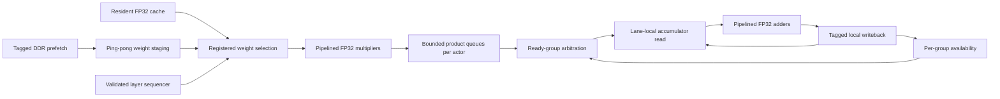

# Proposed layer-streaming FP32 architecture

Status: a [complete serial inference stream](stream/README.md) now implements
three dense layers, hidden activations and output tanh using real FP32 lanes.
The concurrent scheduler, cache/DDR frontend and full-system timing/fit remain
proposed or unverified. Earlier tile RTL and conditional cycle-model evidence are
retained below; they are distinct from the new complete inference simulation.

The requirements remain binary32 weights/activations, 100 MHz, inner
25->256->256->2 at 10 kHz and outer 19->256->256->2 at 1 kHz. No quantization,
checkpoint export, FPGA programming, or actuator connection is involved.

## Current delivery scope: inference input to output

User scope clarification, 2026-10-10: implement the standalone inference path.
The caller supplies prepared binary32 input vectors (25 inner / 19 outer),
streamed binary32 weights and biases, and actor/job identity. The accelerator
returns each actor's two binary32 outputs after tanh through a tagged output
stream with backpressure. Input vectors already have the required observation
ordering and scaling; this hardware milestone does not construct them from
motor measurements or implement observation history or controller action mapping.

The required path is weight loading/cache/prefetch, multi-lane dense execution,
bias initialization, inter-layer activation storage and ReLU, shared tanh,
and ordered output delivery. Preserve the 100 MHz, 10 kHz inner and 1 kHz outer
targets. DDR service, actor scheduling, numerical verification and full-design
resource/timing checks remain relevant to these targets. A simulated weight
source can exercise the stream interface before its DDR backend is integrated.

Motor sensors, ADC/encoder interfaces, coordinate transforms, PWM/inverter
outputs, motor protection, and closed-loop observation/action adapters are
outside this milestone. Complete inference correctness and stream deadlines
are the acceptance boundary; this does not establish closed-loop motor behavior.

## Why change the execution engine

The [bank/cache repair](synth/banking-20261009.md) made memory inference much
smaller, but the core's routed critical path still crosses row selection,
column-progress RAM, rotation/check logic and the state machine. The 12-lane
diagnostic Fmax is 34.74 MHz. Separately, the 16-lane, three-cycle-operator
simulation spends 7,582 cycles in middle-layer commands and 1,920 in output-layer
commands, before between-command DMA and other omitted costs.

Two architectural costs need separate treatment: combinational control/memory
depth limits the clock, while short microtiles, repeated validation/draining,
and accumulation feedback limit the number of cycles. Adding pipeline registers
alone does not remove those execution costs.

## Proposed data path



The initial implementation should remain configurable for 12 and 16 lanes.
Neither width is accepted as fitting until a real FP32 datapath is measured.

1. **Run a layer as a stream.** Validate dimensions, model/job identity, address
   bounds and the expected tile sequence at descriptor admission. A deterministic
   sequencer traverses all output groups for one input column, then advances the
   column. DMA chunks remain transport units: they do not require the entire
   arithmetic pipeline to drain. A buffer can be released only after its last
   response has been captured elsewhere; job completion still waits for all
   arithmetic writes. Layer changes and actor context replacement retain their
   explicit completion rules.
2. **Give each lane fixed row ownership.** Row `r` belongs to lane `r % P` and
   local group `r / P`, for lane count `P`. Validate bounds before issuing the
   stream; use final-group masks for dimensions not divisible by `P`. This
   removes arbitrary accumulator row rotation from every computation. The
   existing 11-bank cache still needs a gather network; register that network
   in the weight frontend, independently of accumulator/control timing. Cache
   layout, byte ordering and DMA identity must be converted explicitly, not
   silently reinterpreted. No new checkpoint layout is exported here.
3. **Multiply ahead of accumulation.** Each product rounds to binary32 and enters
   a credit-controlled queue carrying actor, job/layer, row group, column and
   mask. Fetch the current accumulator after multiplication, close to the
   adder. Returning to a row then waits for accumulator read/add/write visibility,
   rather than the complete multiply-plus-add round trip. FIFO credits include
   results in flight; all variable stalls must propagate without dropping data.
4. **Track availability per fixed group.** Independent groups can occupy a
   pipelined adder while earlier results are in flight. Tag writes by actor and
   group. A deterministic layer sequence replaces repeated per-row progress-RAM
   scans; expected column/group metadata still detects missing, duplicated or
   reordered work. Output/status faults remain sticky and invalidate the job.
5. **Schedule both actors.** Separate product queues avoid an inner output-layer
   recurrence blocking ready outer work at the head of one global FIFO. Give
   deadline-aware priority to ready work and use otherwise idle cycles for the
   other actor. Bounded preemption, memory service and switching costs must be
   modeled together before selecting scheduling quanta. Snapshot/reset/action
   ordering must match the reference controller; this proposal does not impose
   an extra outer-loop delay or alter observation semantics.

Every stage must have a bounded local timing path. Tags and data advance
together through registers. There must be no new same-cycle path from cache
addressing through progress memory to a global state/ready signal. More pipeline
latency is acceptable only when admission credits and independent row groups
keep throughput high.

## FP32 ordering and the two-output layer

Keep the existing explicit arithmetic contract:

```
product[r,c] = RN32(weight[r,c] * input[c])
sum[r,0] = bias[r]
sum[r,c+1] = RN32(sum[r,c] + product[r,c])
```

Products can be calculated early, but additions for each row remain in ascending
column order. Full precision alone does not make a tree reduction, multiple
partial sums, a fused FMA, or an extended-precision accumulator bit-equivalent
to that contract. None of those changes is assumed here. Separate checkpoint
numerical/trajectory parity remains necessary, as in the baseline.

At 12 lanes the hidden layers have 22 independent row groups; at 16 lanes they
have 16. Those groups can hide a sufficiently short feedback interval. The
two-output layer has only one group, so it retains a serial addition dependency.
Multiply-ahead removes multiplication from that recurrence; it does not make
sequential floating-point addition one-cycle or allow batched future observations.

## Conditional compute budget

`sim/stream_budget.py` executes vector issue, bounded product storage, accumulation
and retirement events. It checks column order and every group's completed count.
`M` is multiplier latency, `F` is the entire accumulator feedback interval,
including register-file visibility/forwarding, and `G = ceil(outputs / P)`.
Both operators are assumed to accept independent vectors every cycle. With
sufficient product credits and ready weights/inputs, layer elapsed cycles are:

```
cycles = (inputs - 1) * max(G, F) + (G - 1) + M + F
```

The event model checks this expression independently for every default case.
Layer initialization, weight/cache service, nonlinear activations, controller
work, actor switching and dispatcher costs are excluded. Consecutive layers are
assumed to have their operands ready at the boundary. This is a design budget,
not a simulated full controller or implemented FPGA performance.

The first model run assumes `M=4`, a 16-vector product credit limit, and 100 MHz:

| Lanes | Feedback F | Inner compute | Outer compute | Ten inner + one outer / 1 ms |
| --- | ---: | ---: | ---: | ---: |
| 8 | 8 | 110.66 us | 108.74 us | 121.53% |
| 10 | 8 | 93.80 us | 92.24 us | 103.02% |
| 12 | 8 | 82.56 us | 81.24 us | 90.68% |
| 16 | 8 | 65.70 us | 64.74 us | 72.17% |
| 12 | 12 | 92.88 us | 91.56 us | 102.04% |
| 16 | 12 | 76.02 us | 75.06 us | 83.53% |

The 12-lane/F=8 point leaves only 9,316 cycles per millisecond for all omitted
compute/switch costs and unhidden stalls. A 12-cycle feedback interval makes
12 lanes fail aggregate compute capacity even though the inner compute alone
is below 100 us. Sixteen lanes offer more cycle margin if their actual FP32 area
fits. These are necessary compute checks, not sufficient schedulability proofs.

The model-independent useful-work floor is 72,448 inner MACs and 70,912 outer
MACs. Ten inner jobs and one outer job require 795,392 MACs per millisecond,
or 7.95392 MACs per 100 MHz clock. Eight lanes would require 99.424% useful
occupancy even before tails, serial dependencies and overhead.

## Memory and implementation constraints

Retain the 176 KiB cache implementation as a verified building block, but
re-budget residency and staging with the complete design. Its 44 BRAM36 blocks
leave six blocks on the actual 35T before other memories. The previously
proposed resident inner W0/W2 add another 27 KiB that is not present in this
cache and cannot simply be charged to spare BRAM. LUTRAM, all activations,
accumulators, product queues, DMA/CDC and FP32 operators must be budgeted together.

Required weight payload rates are 1.379328 GB/s with only the 176 KiB inner W1
cache, or 1.102848 GB/s if inner W0/W2 are resident too, with outer weights
streamed. These exclude bias traffic, burst padding, refresh and service gaps.
Average bandwidth is insufficient to prove a deadline: small buffers may not
hold enough outer weights for a long compute slot. Prefetch, queue depths and
interleaving must be checked against a bounded memory-service trace. The compute
model does not yet represent that service.

The first implementation measurement was one real binary32 multiplier,
adder and local accumulator path: numerical behavior, LUT/DSP/FF footprint,
initiation interval, feedback latency and routed 100 MHz timing. The lane now
meets its selected rounding/subnormal tests and is integrated into the serial
stream. Account for complete memory/control and physical timing before settling
on 12 or 16 lanes.
[AMD's published floating-point tables](https://download.amd.com/docnav/documents/ip_attachments/floating-point.html)
report specific out-of-context configurations and explicitly do not guarantee
their timing in larger designs; their other-device numbers are not measurements
of this Arty implementation.

## Reproduction and retained model evidence

```sh
uv run --no-project --with matplotlib==3.10.8 python hw/arty/sim/stream_budget.py
```

First sweep: `results/arty_architecture/stream-20261009T230516-i3lbu8ve`.
It retains all issue/accumulate/retire event CSVs, a metrics JSON, summary,
budget figures, script snapshot, git/submodule identity, versions, configuration,
status and artifact hashes. There is no stochastic seed in this deterministic
model. Failed or future sweeps use new directories. The existing RTL regression
and synthesis results are preserved unchanged.

## Measured-lane follow-up

The [FP32 lane measurement](fp32/README.md) now supplies real operator area and
latency: 6-cycle multiply, 9-cycle add, 11-cycle local feedback, and diagnostic
103.62 MHz for one lane. The updated conditional sweep uses M=7 (including
product FIFO visibility) and F=11: 12 lanes require 90.39 us inner compute and
99.297% aggregate compute occupancy; 16 require 73.53 us and 80.787%. Memory and
other overhead remain excluded. The earlier M=4/F=8 table above is retained as
an explicitly hypothetical comparison, not a measurement of the implemented lane.

Twelve lanes leave just 703 clocks per millisecond for all omitted work. Sixteen
have more cycle margin, but the measured 1,952 logic LUT cells plus LUTRAM/SRL
per lane raise a substantial 35T area concern. Logical LUT counts are not packed
physical sites, so a shared-control multi-lane synthesis is required. Neither
width is accepted as fitting or meeting deadlines. Numerical/routed evidence and
raw traces are linked in the lane report.

## Historical output activation follow-up (before integrated timing cuts)

The [implemented shared CORDIC tanh](tanh/README.md) supplies a measured output
activation candidate: 198-clock worst scalar latency, 397 clocks for two
uncontended outputs, and a diagnostic 100.76 MHz at 1,406 logic LUT cells,
750 FFs, zero DSP/BRAM. It retains binary32 I/O with wider internal guard bits;
29,792 development inputs match reference-rounded binary32 tanh exactly. No
all-input correct-rounding proof or checkpoint parity is claimed.

Only the two actor outputs use tanh, for 22,000 evaluations/s across both rates.
The proposed block diagram now needs one shared activation unit after final
sums, a tagged request queue/inner-priority arbiter, and per-job two-output commit
storage. Output commit storage is implemented in the serial stream; the shared
request queue/arbiter and overlap remain proposed. The concurrent design should
execute another ready job while activation runs. Fully serializing every
job's dense and activation work would take 103.664% of the 1 ms budget at
12 lanes, versus 85.154% at 16. With separate resources, the tanh utilization is
4.378% and is tracked separately; overlap is not yet verified by an integrated
scheduler. Without queue contention, the earlier inner path plus tanh is
94.36 us at 12 lanes or 77.50 us at 16, before DDR/other omitted work.

## Complete serial inference follow-up

The [implemented stream and regression](stream/README.md) replace the conditional
sum of separate block budgets with an actual three-layer RTL path. Ready-source
inner/outer latencies are 9,478/9,337 clocks at 12 lanes and 7,780/7,675 at 16.
They include bias loading, activation RAM/ReLU, layer transitions and two tanh
outputs. They assume a 100 MHz clock and a locally ready LANES-wide weight source;
the cache and DDR are not connected. Independent synthetic reference comparisons
pass at every layer for both widths, including output stalls and fault/reset
recovery. This is not checkpoint or closed-loop parity evidence.

Ten inner jobs plus one outer job would consume 104.117% of a millisecond at 12
lanes or 85.475% at 16 before handover waits. The serial 12-lane version therefore
cannot sustain both rates even with ready data. Source-gap tests push its inner
job to 118.19 us; the tested 16-lane case takes 93.95 us. These injected gaps are
development stimuli, not a DDR service bound. Neither result proves periodic
deadline scheduling. DUT area, full placement/timing and a bounded memory frontend
must be resolved before accepting either width for the Arty A7-35T.

The first integrated physical probe fails: 12 lanes leave 68 required constant
sinks unrouted, and 16 lanes cannot complete legal placement. The 12-lane
placement-only estimate of 51.17 MHz is not a routed clock result. These initial
failures are retained. The current 12-lane follow-up passes the 100 MHz constraint
at **100.65 MHz**, with about 0.065 ns margin, after shared SIMD control, registered
validation/drain/look-ahead addressing, a separate sticky failure latch, exact
FP32 recoder/mask specialization, and tanh input/rounding pipeline changes.
The regular tanh path now takes at most 199 clocks; two outputs take 399.
The open database still represents larger 50T fabric, so actual 35T fit and
timing sign-off remain open. The final 16-lane RTL has functional verification
but no accepted physical probe. Full raw evidence and source identity checks
are linked in the stream report.
